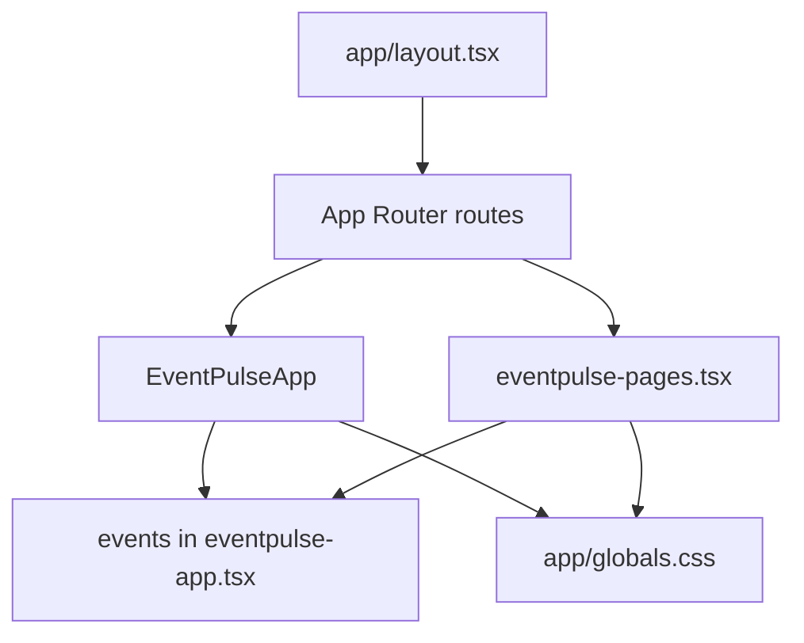
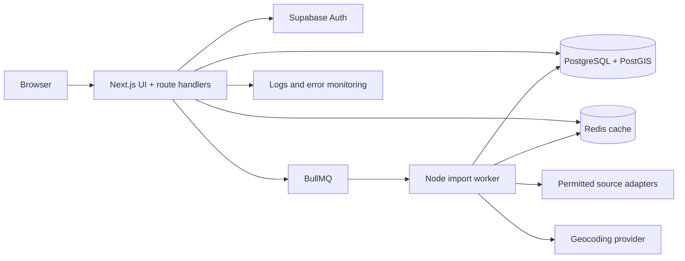
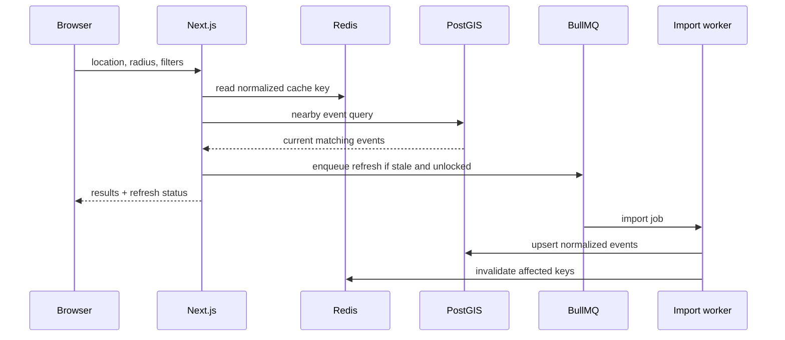

# Architecture

## Current architecture

EventPulse is a Next.js App Router application. `app/page.tsx` renders `EventPulseApp`; route files under `app/discover`, `app/radar`, `app/saved`, `app/events/[id]`, and organizer routes compose page components from `components/eventpulse-pages.tsx`. The root metadata and analytics wiring are in `app/layout.tsx`; global styling is in `app/globals.css`.

`components/eventpulse-app.tsx` is a client component. It owns the exported `events` array, query/filter state, saved IDs, and the location popover. `components/eventpulse-pages.tsx` reuses the same array and has separate local state for saved events and radar radius. There is no shared server data layer, API, database, auth, or server action.

## Proposed target architecture

Use one Next.js application plus one worker process, not microservices. Supabase Auth and PostgreSQL/PostGIS are authoritative. A small Redis/BullMQ deployment is optional P1 infrastructure for asynchronous imports.

Boundaries: the UI renders and sends validated requests; Next.js owns request validation and authorization; Supabase Auth owns sessions; Postgres owns events, users, organizers, bookmarks, and audit records; PostGIS owns distance queries; Redis owns ephemeral cache/locks only; BullMQ owns job delivery; the worker fetches allowlisted sources and normalizes records; geocoding is a replaceable server-side adapter; monitoring records failures without becoming application state.

## Discovery flow

Smallest viable hackathon architecture: Supabase Auth, one Postgres schema with PostGIS, server-side discovery/detail actions, organizer CRUD, and a static allowlisted seed/import command. Add Redis/BullMQ only after the vertical slice works; use an in-process admin-triggered import fallback if infrastructure is unavailable.
