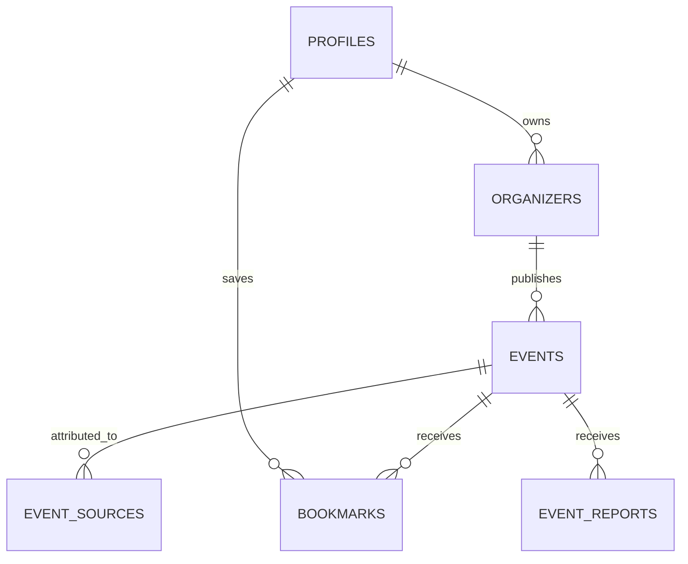

# Data model

## Existing structures

The only documented domain structure is `EventItem` in `components/eventpulse-app.tsx`: `id`, `title`, `category`, `date`, `time`, `venue`, numeric `distance`, `fee`, `source` (`verified | web`), `image`, `accent`, `match`, and optional `deadline`. Four records are exported in `events`. There are no persistence entities or migrations.

## Proposed MVP schema

Use PostgreSQL with PostGIS. `events` is the core table; every coordinate is nullable and must be evidence-based.

| Table | Purpose | MVP | Key fields and constraints |
|---|---|---:|---|
| `profiles` | Supabase user profile | P0 | `id uuid PK references auth.users`, display name, role, created_at |
| `organizers` | Organizer identity and verification | P0 | `id`, `owner_id`, name, description, verification_status; index owner |
| `events` | Canonical event listing | P0 | title, description, category, starts_at, ends_at, timezone, status, format, venue/address/city, `location geography(Point,4326)`, registration_url, fee/currency, organizer_id |
| `event_sources` | Provenance and source identity | P0 | event_id, source_type, external_id/url, last_seen_at; unique `(source_type, external_id)` |
| `bookmarks` | User saved events | P0 | user_id + event_id PK |
| `event_engagements` | Optional aggregateable clicks/views | P1 | event_id, user_id nullable, kind, created_at |
| `import_jobs` | Import run history | P1 | source, area, status, counts, error, started/finished |
| `event_reports` | User moderation reports | P1 | event_id, reporter_id, reason, status |
| `registrations` | Only if EventPulse owns registration | P2 | event_id, user_id, status; otherwise track outbound click |

Recommended event columns also include `registration_deadline`, `eligibility`, `prizes`, `faqs jsonb`, `contact jsonb`, `registration_type`, `source_attribution`, `verification_status`, `registration_status`, `location_resolution_status`, `created_at`, and `updated_at`. Keep event lifecycle (`draft/published/cancelled/expired`) separate from registration (`open/closed/external/unknown`) and organizer verification.

Example migration shape:

```sql
create extension if not exists postgis;
create table events (
  id uuid primary key default gen_random_uuid(),
  organizer_id uuid references organizers(id), title text not null,
  description text, category text, starts_at timestamptz not null,
  ends_at timestamptz, timezone text not null, format text not null,
  venue text, address text, city text, latitude double precision,
  longitude double precision, location geography(Point,4326),
  registration_url text, fee_amount numeric, currency text,
  status text not null default 'draft', registration_status text not null default 'unknown',
  location_resolution_status text not null default 'unresolved',
  created_at timestamptz not null default now(), updated_at timestamptz not null default now()
);
create index events_location_gix on events using gist(location);
```

Deduplicate with source external IDs first, then normalized registration URL, then a reviewable similarity key based on title, organizer, start time, and resolved venue. Never merge uncertain records automatically. An organizer claim should create a verified ownership relationship and preserve source attribution. Missing values remain `NULL` or `unknown`; do not fabricate coordinates or descriptions.

## RLS

Public users may select published events and public organizer fields. Authenticated users may manage only their own profile and bookmarks. Organizers may insert/update events where `organizers.owner_id = auth.uid()`; publishing can require verified organizer status. Reports are insertable by signed-in users and readable by moderators. Moderator actions should use a separate role/claim and audited server-side mutations. Never expose the Supabase service role key in browser code.


