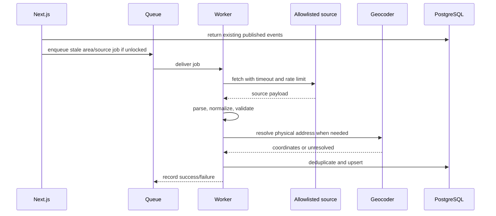

# Scraping and ingestion pipeline

## Current status

No importer, worker, source adapter, fetcher, parser, geocoder, or import endpoint exists. The four records in `events` are hand-authored demo data. No source URL is stored; `source: 'web'` is presentation metadata only.

## MVP pipeline

Use only configured, permitted sources after checking terms, robots guidance, rate limits, and an approved integration path. Source adapters should be explicit and versioned; do not accept arbitrary URLs from unauthenticated users. Trust source IDs, canonical URLs, timestamps, and coordinates only after validation. Missing fields remain unknown. Validate dates/timezones, registration URLs, source attribution, and required title/start fields.

Fetches need timeouts, bounded retries with exponential backoff, per-source throttling, malformed-record isolation, and structured logs. Deduplicate by source ID/URL, then reviewable canonical similarity. Mark listings stale or expired based on source observations and event lifecycle; preserve cancellation signals. Record import run status and errors. Users should receive current results immediately with a non-blocking “refresh in progress” indicator; never hold the discovery request open for scraping.

Uncertain geocoding and duplicate matches go to review. If a source is unavailable, keep prior records with freshness metadata and show a stale state rather than deleting valid data. No specific external site is claimed to be supported by the current code.
